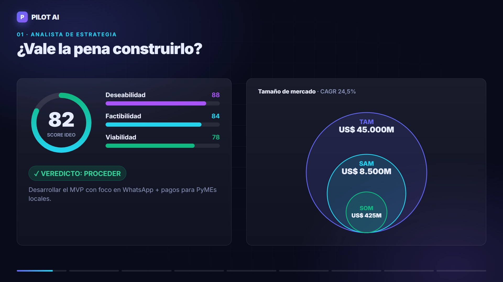
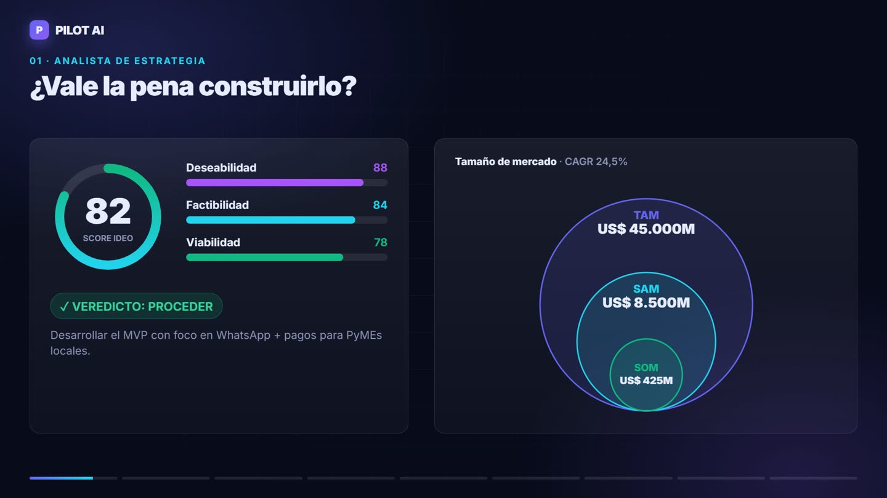
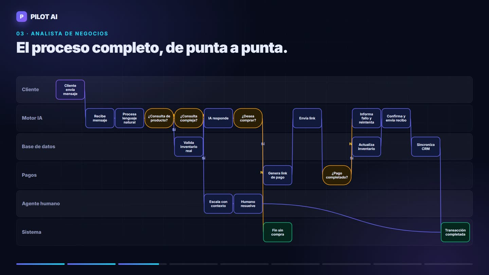
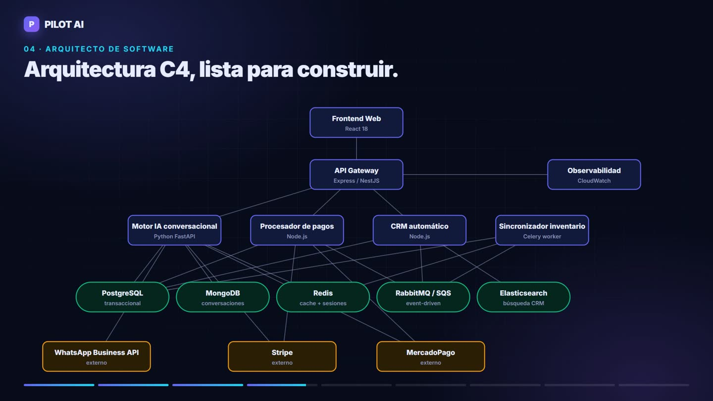
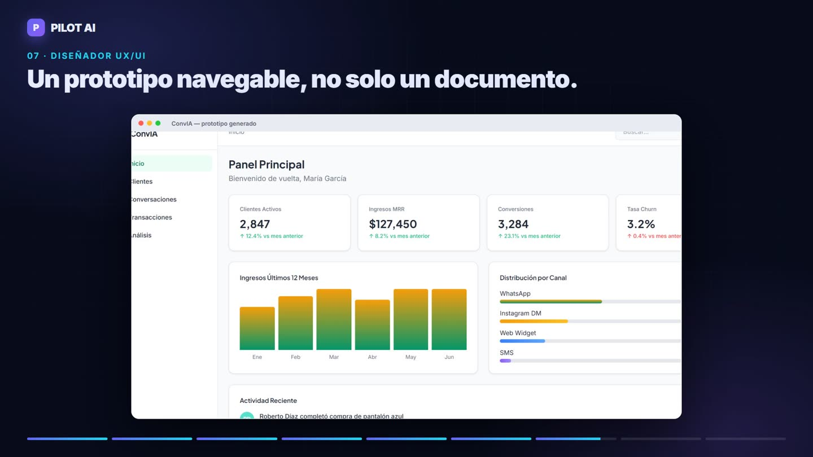
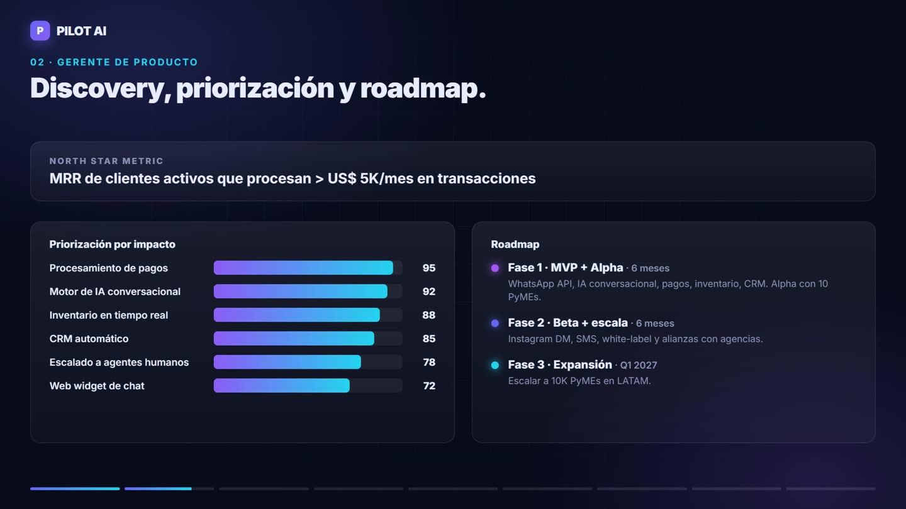
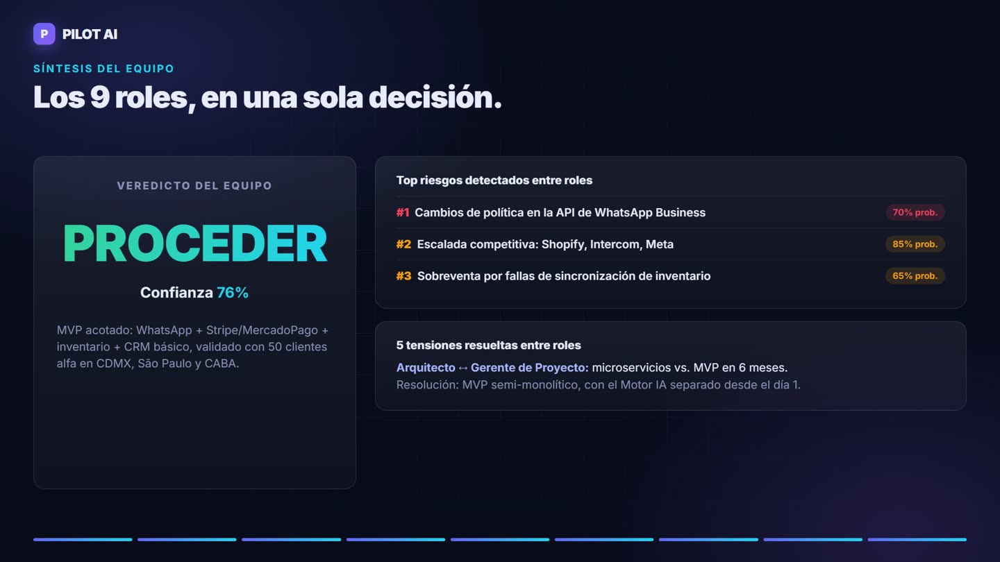

<div align="center">

# 🧭 PILOT AI

**From one idea to a complete, presentation-ready product plan — written by a team of 9 AI roles.**

Strategy · Product discovery · Business processes · Planning · Architecture · UX · QA · DevOps

[](LICENSE)


[**▶ Watch the 90-second demo**](public/demo/pilot-ai-demo.mp4) · [Live site](https://pilot-ai-app.com) · [Run it yourself](#-run-it-yourself-about-20-minutes) · [Español](#-versión-en-español)

[](public/demo/pilot-ai-demo.mp4)

</div>

---

## 💡 What it is

You write an idea in a sentence. Nine role-based agents analyze it **in sequence** — each one reads what the previous roles produced — and a synthesis agent cross-checks the whole team into one executive verdict: **PROCEED, PIVOT or HALT**, with the risks and the disagreements between roles made explicit.

Every analysis exports to **PowerPoint, Word, PDF and Excel**.

> Built as a solo Technical PM project and shared as an open, self-hostable reference: a multi-agent pipeline with real deliverables, a secure server-side proxy, quotas and Row Level Security. **It is not a hosted service** — you run it on your own free Supabase project with your own Anthropic key.

## 👥 The team

| | Role | What it delivers |
|:-:|---|---|
| 🎯 | **Strategy Analyst** | IDEO score (desirability / feasibility / viability), TAM-SAM-SOM, SWOT / TOWS, unit economics, verdict |
| 📦 | **Product Manager** | North Star metric, OKRs, RICE-style prioritization, phased roadmap, discovery questions |
| 📊 | **Business Analyst** | BPMN process map with swimlanes, business rules, user stories, MoSCoW requirements |
| 🗓️ | **Project Manager** | Charter, Gantt, team and budget, PMO / Agile / Hybrid plan |
| 📣 | **Marketing Manager** | Buyer persona, acquisition funnel, channel mix, go-to-market calendar |
| 🏗️ | **Software Architect** | C4 context and container diagrams, data schema, ADRs, quality attributes, tech radar |
| 🎨 | **UX/UI Designer** | A navigable HTML prototype, design system, accessibility and responsive breakpoints |
| 🧪 | **QA Engineer** | Testing pyramid, critical scenarios with coverage, test suites, release readiness |
| ☁️ | **DevOps Engineer** | Infrastructure, CI/CD pipeline with quality gates, SLOs, monitoring, cloud cost estimate |
| ✦ | **Team synthesis** | Team verdict with confidence, cross-role alignments, tensions and how to resolve them, top risks |

## 🖼️ A real run

Idea used: *"An omnichannel AI sales agent for small businesses: sells and answers on WhatsApp, Instagram, SMS and web, connected to inventory, with native payments and automatic CRM."*

| Strategy: is it worth building? | Business Analyst: the end-to-end process |
|:-:|:-:|
|  |  |
| **Architect: C4 containers** | **UX/UI: generated prototype** |
|  |  |
| **Product: prioritization and roadmap** | **Synthesis: one team decision** |
|  |  |

## ⚙️ How it works

```
idea ──▶ role 1 ──▶ role 2 ──▶ … ──▶ role 9 ──▶ synthesis agent
          │           │                 │              │
          └── JSON ───┴── JSON ─────────┴── JSON ──────┘
                                  │
                    exporters: PPTX · DOCX · PDF · XLSX
```

- **Protocols.** Each role has a strict JSON schema plus its methodology (`src/ai/protocols.ts`). Dashboards render that JSON; exporters turn it into documents.
- **Context between roles.** Each role receives the previous analyses, compacted to a fixed budget so long runs never exceed the prompt limit (`src/utils/compactRoleContext.ts`).
- **The browser never talks to Anthropic.** It calls a Supabase Edge Function (`supabase/functions/anthropic-proxy`) that holds the key, enforces a model allowlist, per-user daily quotas and per-plan monthly budgets, and streams the answer back over SSE.
- **Long answers survive time limits.** Heavy roles (Architect, UX) can outlive the Edge Function wall clock (150 s on Supabase Free). When a stream is cut, the client resumes generation from the partial output instead of failing.
- **Data isolation** is enforced by Postgres Row Level Security (`supabase/migrations/`).

**Stack:** React 18 · TypeScript 5 · Vite 5 · Tailwind 3 · i18next (ES/EN) · Recharts · React Flow + Dagre · pptxgenjs · docx · jsPDF · xlsx-js-style · Supabase (Postgres, Auth, Edge Functions on Deno) · Anthropic Claude (Haiku 4.5 by default)

---

## 🚀 Run it yourself (about 20 minutes)

**You need:** Node 20+, Git, a free [Supabase](https://supabase.com) account and an [Anthropic](https://console.anthropic.com) API key with some credit.

> 💸 **Cost.** Analyses run on *your* key. As a rough estimate, a full 9-role run plus synthesis costs about **US$ 1.5–3 on Claude Haiku 4.5**, depending on the idea and on how much context the roles pass along. Running a few roles costs proportionally less.

### 1. Create the accounts

1. [supabase.com](https://supabase.com) → **New project**. Write down the **project ref** (the 20-character id in the project URL).
2. [console.anthropic.com](https://console.anthropic.com) → **API keys** → create one (`sk-ant-...`).

### 2. Clone and install

```bash
git clone https://github.com/Rober2050/pilot-ai.git
cd pilot-ai
npm install
```

### 3. Set up Supabase (one command)

```bash
npx supabase login
./scripts/setup-supabase.sh <project-ref> <sk-ant-your-key>
```

The script links the project, applies the migrations (schema, the 9 roles with their prompts, plans, security policies), stores your Anthropic key as a **server-side secret** and deploys the proxy.

<details>
<summary>On Windows without Git Bash</summary>

```bash
npx supabase link --project-ref <project-ref>
npx supabase db push
npx supabase secrets set ANTHROPIC_API_KEY=sk-ant-...
npx supabase functions deploy anthropic-proxy
```
</details>

### 4. Configure the frontend

```bash
cp .env.example .env.local
```

Paste the two values from **Supabase → Project Settings → API**:

```
VITE_SUPABASE_URL=https://<project-ref>.supabase.co
VITE_SUPABASE_ANON_KEY=<anon public key>
VITE_ENABLE_PUBLIC_SIGNUP=true
```

`VITE_ENABLE_PUBLIC_SIGNUP=true` lets you create your own account. (The hosted showcase keeps it off and works by invitation.)

The register button is only UI. To really close sign-ups, turn on the database gate from migration `007_invite_only_signup.sql`; after that, only emails in `public.invitations` (created from the admin console) can register:

```sql
UPDATE public.system_config SET is_enabled = true WHERE id = 'invite_only_signup';
```

Do not use Supabase's "Allow new users to sign up" switch for this: invited users register through that same endpoint and would be locked out.

### 5. Run your first analysis

```bash
npm run dev
```

1. Open http://localhost:5173 and **register** with your email.
2. **Confirm** the email Supabase sends you (the proxy rejects unconfirmed accounts).
3. Make yourself **admin** so plan limits don't get in the way — Supabase → SQL Editor:
   ```sql
   SELECT public.promote_to_admin('you@example.com');
   ```
4. Write an idea, pick the roles and run. Export any role to PPT, Word, PDF or Excel.

<details>
<summary>Deploy the frontend (optional)</summary>

It is a static Vite build. Vercel, Netlify or Cloudflare Pages work with defaults: build `npm run build`, output `dist`, plus the `VITE_*` variables in the host settings. Then allow your domain in the proxy:

```bash
npx supabase secrets set ALLOWED_ORIGINS=https://your-app.example.com
npx supabase functions deploy anthropic-proxy
```
</details>

<details>
<summary>Cost controls you can tune</summary>

In `supabase/functions/anthropic-proxy/index.ts`:

| Knob | Default | Meaning |
|---|---|---|
| `ALLOWED_MODELS` | Haiku 4.5 | Models the client may request |
| `MAX_TOKENS_CAP` | 64k | Ceiling per request |
| daily quota | ~3 full runs | Per-user hard stop per UTC day |
| `PLAN_MONTHLY_TOKEN_BUDGET` | per plan | Monthly budget by subscription plan |

Redeploy the function after changing them. Also set a monthly spend limit in the Anthropic console.
</details>

---

## 🗂️ Project layout

```
src/
├── ai/                 protocols.ts (role schemas + methodology), promptEngine.ts
├── services/
│   ├── ai/             provider factory, SynthesisAgent, JSON recovery
│   ├── export/         exportRegistry, contentNormalizer, documentRenderer, ppt/, drivers/
│   └── firebase/       data services on Supabase (folder name is historical)
├── components/         dashboards, ResultsWorkspace, role panels
├── pages/              StrategyHub (main workspace), ProjectList, AdminConsole, ...
├── i18n/               ES + EN
└── types/              blueprint.ts is the central model
supabase/
├── migrations/         001 schema · 002 proxy usage ledger · 003 seed roles/plans · 004 security
└── functions/anthropic-proxy/
```

More in [ARCHITECTURE.md](ARCHITECTURE.md), [FEATURES.md](FEATURES.md) and [docs/DEPLOYMENT.md](docs/DEPLOYMENT.md).

```bash
npm run dev     # Vite dev server
npm run build   # tsc + vite build
npm run test    # Vitest
```

## ⚠️ Known limitations

- Outputs are written by an LLM: treat numbers (market size, unit economics, costs) as a first draft to validate, not as facts.
- Few automated tests; exporters and role protocols were mostly validated by hand.
- The `services/firebase/` folder name predates the move to Supabase.
- War Room is experimental and on hold.
- Every AI call goes through the `anthropic-proxy` Edge Function with Claude Haiku 4.5; there are no other providers in the code.
- The analysis has no web access: market figures are model estimates and are labelled as such.
- Voice input is browser dictation (Web Speech API); audio files are not supported because Claude does not read audio.

## 📄 License

MIT with Commons Clause: free to use, modify and self-host; not to be sold as a service. See [LICENSE](LICENSE).

Built by **Roberto Abadía** · [pilot-ai-app.com](https://pilot-ai-app.com)

---

## 🇪🇸 Versión en español

**PILOT AI** toma una idea escrita en una frase y la pasa por **9 roles de IA en cadena** — estrategia, producto, negocios, proyecto, marketing, arquitectura, UX/UI, QA y DevOps —, donde cada rol trabaja sobre el análisis de los anteriores. Al final, un agente de síntesis cruza todo y emite un **veredicto del equipo** (PROCEDER, PIVOTAR o DETENER) con los riesgos y las tensiones entre roles. Todo se exporta a **PowerPoint, Word, PDF y Excel**.

No es un servicio alojado: lo corrés en tu propio proyecto gratuito de Supabase con tu propia clave de Anthropic. **Los tokens los pagás vos** — como estimación, una ejecución completa de los 9 roles cuesta unos **US$ 1,5–3 con Claude Haiku 4.5**.

### Instalación en 5 pasos (unos 20 minutos)

1. **Cuentas:** creá un proyecto en [supabase.com](https://supabase.com) (anotá el *project ref*) y una API key en [console.anthropic.com](https://console.anthropic.com).
2. **Código:**
   ```bash
   git clone https://github.com/Rober2050/pilot-ai.git
   cd pilot-ai
   npm install
   ```
3. **Supabase (un comando):**
   ```bash
   npx supabase login
   ./scripts/setup-supabase.sh <project-ref> <sk-ant-tu-clave>
   ```
   Crea las tablas, carga los 9 roles, aplica la seguridad, guarda tu clave **del lado del servidor** y despliega el proxy.
4. **Frontend:** `cp .env.example .env.local` y completá `VITE_SUPABASE_URL` y `VITE_SUPABASE_ANON_KEY` (Supabase → Project Settings → API). Dejá `VITE_ENABLE_PUBLIC_SIGNUP=true` para poder crear tu cuenta.
5. **Correr:** `npm run dev`, abrí http://localhost:5173, registrate, confirmá el mail y hacete admin en el SQL Editor de Supabase:
   ```sql
   SELECT public.promote_to_admin('tu@email.com');
   ```
   Escribí una idea, elegí los roles y ejecutá.

Los detalles de cada paso, el despliegue y los controles de costo están en la sección en inglés.
